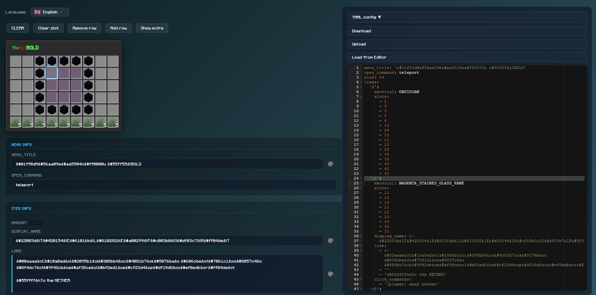
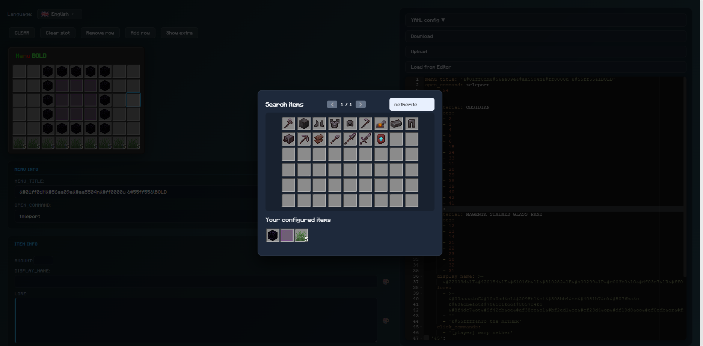
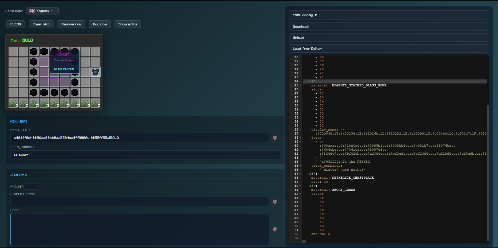
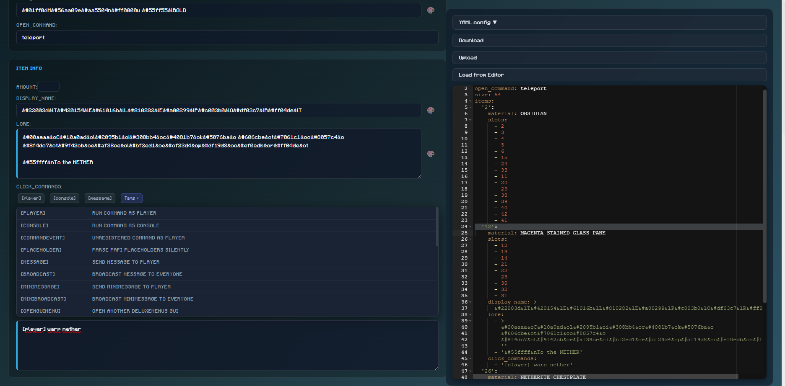
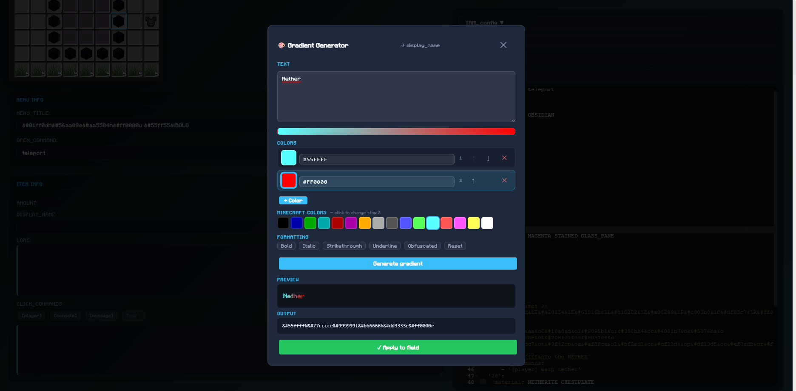

# DeluxeMenus Editor

A visual web editor for creating and maintaining [DeluxeMenus](https://www.spigotmc.org/resources/deluxemenus.11734/) menu configurations for Minecraft servers.

This project helps you build menu layouts faster with a grid-based item editor, live YAML workflow, item search, gradient text generation, and command helper tags.

## Features

- Visual inventory/grid editor for menu items
- Built-in YAML editor with load/reset workflow
- Item search and quick item assignment
- Gradient generator for display name and lore
- Command quick-actions and tag helper list for click command fields
- Multi-language UI support (8 languages)

## Screenshots

### 1. Main Editor Layout
A quick look at the overall interface and layout.



### 2. Item Search
Search and pick Minecraft items quickly.



### 3. Gradient Preview Support
Gradient preview and generation workflow for text fields.



### 4. Command Tag Help
Built-in helper list for command tags.



### 5. Color Helper for Text Fields
Color helper support for lore, display name, and menu title.



## Getting Started

### Prerequisites

- Node.js 16+
- npm

### Install

```bash
npm install
```

### Run Development Server

```bash
npm start
```

### Production Build

```bash
npm run build
```

## Deployment

The app is deployed as part of the [mc-api](https://mc-api.kulih.eu) site and is
live at **https://mc-api.kulih.eu/dm-editor/**.

The source lives in the `dm-editor-src/` directory of the mc-api project, so the
editor and the site it belongs to stay together. The production base path is
set by the `homepage` value in `package.json` (currently `/dm-editor/`), so all
bundles and item icons are loaded from that sub-path.

Build and publish from that directory:

```bash
cd dm-editor-src
./deploy.sh
```

`deploy.sh` runs `npm run build`, drops the source maps and copies `build/`
into `../public/dm-editor/` (pass another directory as the first argument to
deploy elsewhere).

### Test build

`./deploy-test.sh` builds the same source with `"homepage": "/dm-editor/test/"`
and publishes it to `../public/dm-editor-test`, served at
**https://mc-api.kulih.eu/dm-editor/test/** with a `noindex` robots tag.
The test build keeps its drafts in a separate `state_test` localStorage slot,
so experimenting there never touches the production editor state.

The API server serves that folder with `express.static` before rate limiting;
see `src/api/app.ts` in the mc-api repo. No server restart is needed — only a
browser refresh (hashed JS/CSS files are immutable, the HTML shell is
`no-store`).

`npm run deploy` (GitHub Pages) is no longer used by this deployment.

### Branding

The editor uses the same visual language as the rest of mc-api.kulih.eu:

- palette tokens (`--bg`, `--accent`, …) are defined at the top of
  [src/App.css](src/App.css) and must match the site's `:root` block,
- the shared site header is injected by mc-api at request time (it is not part
  of this build), so navigation links are maintained in one place,
- the favicon, `theme-color`, canonical URL and Open Graph tags live in
  [public/index.html](public/index.html).

## Tech Stack

- React 16 (Create React App)
- react-ace + js-yaml
- react-modal
- react-colorful

## Contributing

Contributions are welcome. If you want to help, please open an issue first (feature request or bug report), then submit a pull request.

### Add a New Language

1. Copy [src/lang/english.json](https://github.com/1101Martin1101/DeluxeMenus-Editor/blob/master/src/lang/english.json).
2. Rename the copied file to your language code/name (must match the value used in the language list).
3. Translate all keys.
4. Add your language to [src/inventory.js](https://github.com/1101Martin1101/DeluxeMenus-Editor/blob/master/src/inventory.js) in the LANGLIST array.
5. Open a pull request.

### Add a New Field

1. Open [src/inventory.js](https://github.com/1101Martin1101/DeluxeMenus-Editor/blob/master/src/inventory.js) and add a field object in fields().
2. Add a matching translation key in [src/lang/english.json](https://github.com/1101Martin1101/DeluxeMenus-Editor/blob/master/src/lang/english.json).
3. Ensure the field maps correctly to YAML export/import.
4. Open a pull request.

Field object example:

```js
{
	name: LANG['your new field'],
	value: 'your_new_field',
	extra: false,
	type: 'text',
	tagName: 'input'
}
```

- name: label from language file
- value: YAML key
- extra: if true, hidden by default
- type: number | checkbox | text
- tagName: input | textarea

## Credits

- Original project: [TABmk/deluxemenus-editor](https://github.com/TABmk/deluxemenus-editor)
- Fork reference: [vanhauluonsuy/deluxemenus-editor](https://github.com/vanhauluonsuy/deluxemenus-editor/)
- Item textures credit: [mc.nerothe.com](https://mc.nerothe.com)

